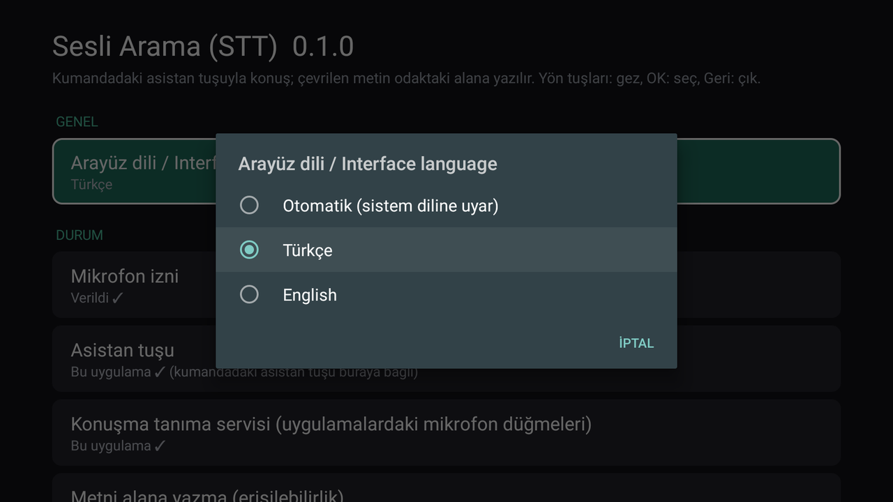
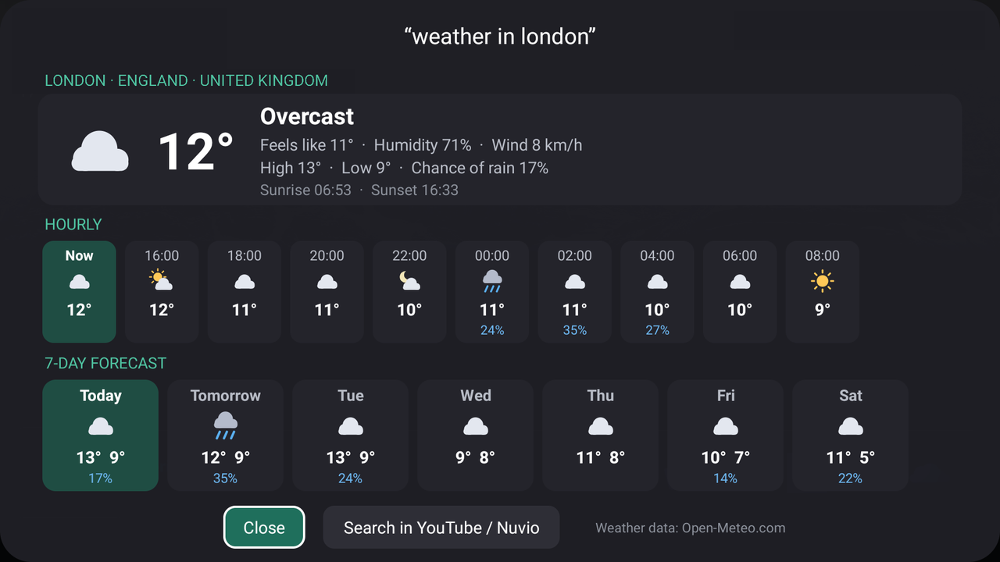
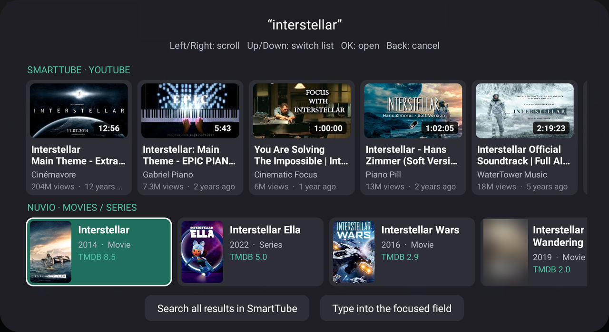
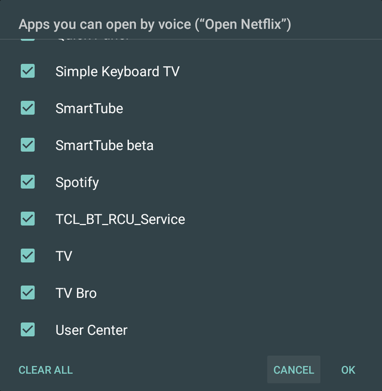

# Voice Search (STT) — a lightweight, cloud-based speech-to-text app for Android TV

  

A small Android TV app that takes over the remote's **assistant / microphone key**: you speak, the audio is transcribed by a
cloud speech-to-text API (Groq `whisper-large-v3-turbo` by default; any OpenAI-compatible endpoint works), and the text is
typed into the focused field, searched in **SmartTube** and **Nuvio** (Google-Assistant-style result cards), or — for weather
questions — shown as a **weather panel**. Derived from the architecture of [Sayboard](https://github.com/ElishaAz/Sayboard) (GPL-3.0);
there is no on-device speech model, RAM/CPU use is tiny, and the microphone is only open while you speak.

The app, the installer and the voice commands work in **English and Turkish**
(Settings → *Interface language / Arayüz dili*; "Automatic" follows the TV's system language).

<p align="center"></p>

> Developed and tested on a **TCL Smart TV Pro (Android 11)** only. Provided **as is**, without warranty (GPL-3.0).
> Not affiliated with SmartTube, Nuvio, BitChord, Spotify, Apple, MusicLink, Groq, OpenAI, TMDB, YouTube or Open-Meteo.

<p align="center">
  
  
</p>

Everyday voice commands — volume, sleep timer, music control, and opening apps (Settings › *Apps opened by voice* chooses which apps may be opened):

<p align="center">
  
  
  
</p>
<p align="center"></p>

## What it does

- **The remote's assistant/microphone key opens this app** (it is set as the default assistant).
- Press the key → speak → on silence (or OK) the speech is transcribed → the text is **typed into the focused search/text field**.
  If no field is found, the text is copied to the clipboard and shown on screen.
- **Pauses the music while you speak**: when listening starts, the app asks for temporary (transient) audio focus. Players that honor it (BitChord, most video apps) pause and resume by themselves when you are done; players that ignore audio focus keep playing. If the result opens another app (SmartTube, Nuvio, BitChord) the focus is given back a few seconds later, so the old sound does not flash back on first.
- The app also registers itself as the system speech recognizer (`SpeechRecognizer` / `RECOGNIZE_SPEECH`), but how other apps' own microphone buttons behave is up to those apps. In my testing SmartTube's own in-app voice search did **not** work while this app was installed.
- **Searches SmartTube and Nuvio together** (changeable in Settings):
  - *Search both* (default): after you speak, two rows of horizontal cards appear: **SmartTube · YouTube** videos on top (thumbnail,
    duration, channel, views, date) and **Nuvio · Movies / Series** below (poster, year, rating, genre, overview). Left/Right: browse,
    Up/Down: switch rows, OK: open (videos play in SmartTube, titles open in Nuvio). Buttons at the bottom: *Search all results in
    SmartTube* and *Type into the focused field*.
  - *Always SmartTube* opens SmartTube's search results directly; *Always Nuvio* shows only the Nuvio row; *Only type into the field* is the plain dictation mode.
  - The YouTube row uses a keyless web search; you can enter a YouTube Data API key in Settings. Nuvio has no search deep link, so titles come
    from Cinemeta (keyless); with a TMDB key you also get localized titles.
- **Weather**: say "weather in London", "what's the weather like in Paris tomorrow", "will it rain tomorrow", "how many degrees is it in
  New York", "day after tomorrow weather in Berlin" (Turkish: "İstanbul hava durumu", "yarın Ankara'da hava nasıl olacak" …) and **only the weather panel**
  opens (current conditions, hourly and 7-day forecast; Open-Meteo, keyless). "Tomorrow" / "day after tomorrow" show that day's summary.
  If you don't name a city ("weather"), the default city from Settings is used (London in English, İstanbul in Turkish — change it in Settings).
  Everything that is not a weather question is searched as before; if the spoken place isn't a real place, it falls back to a normal search.
  Fahrenheit and mph are used when the interface is English and the TV's region is the US. The panel has *Close* and *Search in YouTube / Nuvio* buttons.
- **App-prefixed voice commands** (both languages; not used in *Only type into the field* mode):
  - **`bitchord <song>`** plays the best match in [BitChord](https://github.com/kushagrasinghx/BitChord) (the Android TV build must be installed): "bitchord duman bal aç", "play Blinding Lights on bitchord".
    The music starts in the background and a small card shows what is playing. BitChord TV's own screen ignores voice/search links, so this app connects to BitChord's
    media service and sends the standard *play from search* command (the one assistants use). BitChord needs internet to search.
  - **`spotify <song>`** plays the song in Spotify TV: "spotify duman bal", "play Blinding Lights on spotify". Spotify's TV app answers a voice *search* with its own *top results*
    screen instead of playing, but it does play a `spotify:track:` link started over its media service. So the app first looks the song up (see *Spotify song lookup* below), sends that link
    the way an assistant would, and the moment Spotify brings its own player screen to the front the app presses *Home* (through the accessibility service if it is on, otherwise a home intent):
    the music keeps playing and you are back on the home screen. Settings › Music › *Spotify player screen* chooses between this (*Background*, default) and leaving Spotify's screen open. *BitChord player screen* is the same choice for BitChord: it plays without any screen by default, or can open BitChord's own screen once the song starts. Without a lookup set up (or if it finds nothing) the app falls back to the top-results
    screen: press **OK** to play the highlighted result; the old song is paused so it doesn't come back while you choose. Spotify must be installed and signed in.
  - **Music without naming the app**: "duman bal çal", "tarkan şımarık dinle", "listen to Blinding Lights", "müzik aç duman bal", "play music Blinding Lights" use the app chosen in
    Settings › Music › *Music app* (*Automatic* = the music app you used last, otherwise the first installed one: Spotify, then BitChord; or a package name you type).
  - **`nuvio <title>`** and **`smarttube <query>`** only *search* in that app, whatever the Search target setting is (Nuvio: result cards; SmartTube: its search screen).
  - Only the app name plus "aç / open" ("spotify aç", "open nuvio") just opens that app.
  - Only tested with BitChord TV 1.9 and Spotify TV 1.134 on one TV. If the app is not installed the card says so.
  - The app name may also come last ("duman bal bitchord'da çal"). Verbs such as *aç / çal / dinle / ara / play / open / search* are dropped from the query.
  - **Mis-heard app names**: speech recognition often writes foreign names the way they sound in Turkish ("bitçörd", "bit chord", "spotifay", "smart tüp"). The app compares words by *sound*
    (letters that sound alike are merged, vowels are loosened) instead of exactly, and the app names are also given to the speech API as a spelling hint.
- **Everyday voice commands** (both languages; checked before searching, not used in *Only type into the field* mode). Only whole short sentences count, so a song or film called "Stop" is still searched:
  - **Music control** — works on whatever player was active last (BitChord, Spotify, video apps): "durdur", "devam et", "sonraki şarkı", "önceki şarkı", "müziği kapat" /
    "pause", "resume", "next song", "previous song", "stop the music". The app sends the standard media keys to that player.
  - **Volume** — "sesi aç / kıs", "sesi yükselt / azalt", "sesi yüzde 30 yap", "sessize al", "sesi geri aç" / "volume up / down", "set volume to 40", "mute", "unmute".
    A step is five notches of the remote's volume key. Some TVs (an HDMI-ARC sound bar, for example) accept only one notch per call, so the app moves the volume notch by notch and
    checks each one: a big jump takes a few seconds (about 0.4 s per notch). Mute depends on what your TV does with the system mute.
  - **Sleep timer** — "30 dakika sonra müziği durdur", "yarım saat sonra kapat", "1 saat 30 dakika sonra durdur" / "stop the music in 30 minutes", "pause in an hour";
    "zamanlayıcıyı iptal et" / "cancel the timer" removes it. When the time is up the music is paused (the TV is not switched off). One timer at a time; a new one replaces the old one. 1 minute to 12 hours.
  - **Open any installed app** — "prime video aç", "open aurora", "launch smart tube". The app's name is matched by sound, like the music apps above ("youtube aç" opens SmartTube, "ayarlar aç" / "open settings" the TV's settings).
    Settings › *Apps opened by voice* lists every launchable app on the TV: untick the ones that must not open by voice, or use *Select all / Clear all*. A name that matches no app is searched as usual.
- **Spotify song lookup** (optional; Settings › Music): Spotify's own search is not open to apps without a key, so playing a song directly needs a free key for one of these:
  - **Spotify Web API** (best: Spotify's own ranking, ~0.3 s): create an app at [developer.spotify.com/dashboard](https://developer.spotify.com/dashboard) (Spotify requires the owner to have **Premium**
    for such apps) and enter its *Client ID* and *Client Secret*. Only Spotify's public catalog search is used (client-credentials token, no login). If Spotify refuses the keys (typically HTTP 403 because the owner has no Premium) they are skipped for 30 minutes and MusicLink is used.
  - **MusicLink** (no Premium needed): sign up at [musiclink.one](https://musiclink.one) (free key, 300 lookups a month) and enter the *API key*. The best match of Apple's public iTunes Search
    is mapped to its Spotify track. (The free Odesli/song.link API this idea started with was shut down in 2026.)
  Spotify keys are tried first, then MusicLink; keys are stored only on the TV. With neither, `spotify <song>` opens the results screen as described above.
- **Choose the music app** (Settings › Music › *Music app*): *Automatic* (default), Spotify, BitChord, or *Enter another package name…* (any app with a public media service). Installed ones are marked ✓.
- **Choose the SmartTube / Nuvio package** (Settings › Search target › *SmartTube package*, *Nuvio package*): *Automatic* (default), a preset list,
  or *Enter another package name…*. Presets: SmartTube `org.smarttube.stable`, SmartTube Beta `org.smarttube.beta`; Nuvio `com.nuvio.tv` (original),
  Nuvio Arc `com.nuvio.tv.test`, Nuvio Native Legacy `space.nuvio.nativelegacy`, Nuvio Reshaped `com.nuvioreshaped.tv`. Installed ones are marked ✓.
- **Fully remote-controlled** (arrows, OK, Back). No touch needed.
- **API settings live inside the app**: provider (Groq / OpenAI / your own server), address, key, model, speech language, silence length, etc.
  (*Speech language* is the language Whisper listens for; it is separate from the interface language.)

## Remote control

| Key | In Settings | On the listening screen |
|---|---|---|
| Up / Down | Move between rows | — |
| OK | Open / change the row | Finish speaking now and transcribe |
| Assistant key | (main function) start listening | Finish speaking now |
| Back | Exit | Cancel |

## Quick install (Windows — recommended)

1. Download **`VoiceSearch-installer.zip`** from the [Releases](../../releases) page and extract it into one folder (keep the files together).
2. **One-time preparation on the TV:** Settings → Device Preferences → About → press OK on *Build* 7 times (developer mode).
   Then Developer options → turn **USB debugging** (and **Network debugging**, if present) *ON*. Note the TV's IP address (Settings → Network & Internet).
3. Double-click **`install.bat`** (the installer's language follows Windows) and enter the TV's IP address. On the first
   connection the TV asks "Allow USB debugging?" — choose **Always allow**. (The computer and the TV must be on the same router.)
4. Optionally paste your Groq API key ([get a free key](https://console.groq.com/keys)); if you leave it empty you can enter it later in the app's Settings.
5. When you see "SETUP COMPLETE", press the **assistant / microphone key** on the remote and speak.

`install.bat` does this: offers to download adb from Google's official address if needed → connects to the TV → installs (or updates) the APK →
grants the microphone permission → sets the app as default assistant, speech-recognition and accessibility service → (optionally) sends the API
key to the TV → opens the Settings screen. Log: `install.log`. To undo: `install.bat uninstall` (restores the previous assistant settings and removes the app).

- Unattended: `install.bat auto` (the TV address must be in `tv.txt` or the `VT_TV` environment variable; `VT_KEY` for the API key).
- Force the installer language with `VT_LANG=en` or `VT_LANG=tr`.
- If the installer fails, read `install.log`. Most common causes: debugging is off on the TV, a wrong IP, or the TV's permission prompt was not accepted.
- The API key is sent over adb to the app's internal settings receiver (`ConfigReceiver`); it requires `android.permission.DUMP`, so only adb/shell can send it
  and no other app on the TV can change settings. The key is never written to logs.
- The release APK is signed with the debug key (personal use). If you don't want to trust a prebuilt APK, build it yourself (`scripts\release.bat` → `dist\`).

## Build from source (developers)

You need **Android Studio** (comes with the SDK and platform-tools) and a computer on the same network as the TV.

1. Enable network debugging on the TV (see above). The port is usually `5555`.
2. Copy `scripts\tv.example.txt` to `scripts\tv.txt` and write `IP:5555` in it (e.g. `192.168.1.50:5555`).
3. API key (free): get a Groq key at <https://console.groq.com/keys>. Copy `scripts\config.example.json` to `config.json` in the project root and put
   it in `apiKey` (the key is not embedded in the APK; it is sent to the TV at install time and the file is deleted once imported). You can also skip this and enter the key in the app.
4. Run `scripts\build.bat` → `app\build\outputs\apk\debug\app-debug.apk`
5. With the TV on, run `scripts\install.bat`: it installs the APK, grants the microphone permission, makes the app the **default assistant + speech-recognition + accessibility service** and opens Settings.

Translations live in `app/src/main/res/values/strings.xml` (English, the default) and `values-tr/strings.xml` (Turkish); `Lang.kt` picks the language at run time.

### Test

1. Open the app ("Voice Search (STT)" in the app list; "Sesli Arama (STT)" on a Turkish TV).
2. *Test the connection* → you should see "OK".
3. *Microphone / listening test* → speak; the level should move.
4. Go to a search box, press the **remote's microphone key** and speak.

### Troubleshooting

| Symptom | What to do |
|---|---|
| Pressing the mic key **does nothing** (TCL / MediaTek TV) | Root cause: the TV firmware blocks 3rd-party apps from being started in the background through the `APP_AUTO_START` permission (default *ignore*); the system can't bind to our assistant service and remembers the failure. `scripts\setup.bat` grants the permission (`cmd appops set … APP_AUTO_START allow`) and resets the binding. It persists across reboots; the script re-applies it on every install. |
| The mic key still opens Google Assistant | Run `scripts\keys.bat` and press the key; see whether it appears in `logs\keys.log`. Also try *Remote key test* in the app. Then `scripts\logcat.bat clear`, press the key, `scripts\logcat.bat` and read `logs\logcat.log`. |
| The remote's microphone is silent (level always 0) | Some remotes send audio over Bluetooth/a private channel and don't expose it to 3rd-party apps. Try *Audio source* and *Microphone device* in Settings; otherwise you need a USB or phone microphone. |
| Text isn't typed, it is copied to the clipboard | The accessibility service may be off (see the status row on the main screen) or the app's search box is non-standard. |
| "No connection / 401" | Check the address, key and model in Settings. |
| Filing an issue? | Attach `install.log` / `logs\*.log` only **after replacing your TV's IP address with `x.x.x.x`**, and never paste an API key (or any part of one) anywhere public. |
| Go back to the original state | `scripts\restore.bat` — restores the assistant / recognition / accessibility settings from before the install. |

## Manual commands (if you prefer not to use the scripts)

```
adb connect IP:5555
adb install -r -g app\build\outputs\apk\debug\app-debug.apk
adb shell pm grant com.voiceasistanttv.stt android.permission.RECORD_AUDIO
adb shell settings put secure voice_recognition_service com.voiceasistanttv.stt/com.voiceasistanttv.stt.CloudRecognitionService
adb shell cmd appops set com.voiceasistanttv.stt APP_AUTO_START allow
adb shell cmd role add-role-holder android.app.role.ASSISTANT com.voiceasistanttv.stt
adb shell settings delete secure voice_interaction_service
adb shell settings put secure assistant com.voiceasistanttv.stt/com.voiceasistanttv.stt.AssistService
adb shell settings put secure voice_interaction_service com.voiceasistanttv.stt/com.voiceasistanttv.stt.AssistService
adb shell settings put secure enabled_accessibility_services com.voiceasistanttv.stt/com.voiceasistanttv.stt.InjectorService
adb shell settings put secure accessibility_enabled 1
```

## API providers

It uses `POST {address}/audio/transcriptions` (OpenAI compatible), so it works with:

- **Groq** (default, free tier): `https://api.groq.com/openai/v1`, model `whisper-large-v3-turbo`
- **OpenAI**: `https://api.openai.com/v1`, model `gpt-4o-mini-transcribe` / `whisper-1`
- **Your own server** (e.g. faster-whisper-server on your LAN): `http://192.168.1.10:8000/v1`, the key may be empty

## Privacy

- **Audio**: your speech is sent to the API provider you choose (default Groq) and nowhere else; the app doesn't store it. The microphone is only used while the listening screen is open. Check the provider's data-use terms for free tiers. If you pause for about half a second the clip is sent right away (see Performance); if you keep talking, that early answer is discarded and the whole phrase is sent again, so a long phrase with pauses can cost one extra request.
- **Recognized text**: searched words go to YouTube (keyless web search), Cinemeta / TMDB (movies/series) and — for weather questions — Open-Meteo (the city name only).
- **Spotify song lookup** (only if you entered keys): the recognized song words go to Spotify's search (`api.spotify.com`, with your own app's token from `accounts.spotify.com`), or — with a MusicLink key — to Apple's iTunes Search (the words only) and then MusicLink (an Apple Music song link plus your key). Nothing else is sent.
- **Voice commands for music, volume, the timer and opening apps** are handled on the TV: nothing besides the transcription request leaves the device for them. The list of installed apps is read locally (it is only used to match what you said) and is never sent anywhere.
- **Connection warm-up**: when listening starts, the app sends empty `HEAD` requests to the search servers (YouTube, TMDB, Groq) so results arrive faster. If Spotify is your music app and a song-lookup key is set, the same is done for the lookup servers (Apple's iTunes Search + MusicLink, or the Spotify Web API). They contain no speech or personal data; the servers only see that a connection was made (your IP address).
- The **accessibility service** doesn't read or record screen content; after you speak it only finds the focused text field and types the text there. It is also used to press *Home* once (when Spotify's own player screen opens over a `spotify` command; can be turned off in Settings › Music).
- API keys are kept only in the app's settings on the TV (not embedded in the APK, not logged).
- No analytics, ads or tracking.

## Credits

- Weather data: **[Open-Meteo.com](https://open-meteo.com/)** (CC BY 4.0), also credited in the weather panel.
- Movie/series data: Cinemeta (Stremio) and optionally TMDB. *This product uses the TMDB API but is not endorsed or certified by TMDB.*
- Video search comes from YouTube; results open in SmartTube. SmartTube and Nuvio are separate apps; this project is not affiliated with them and does not include them — you install them yourself.
- Architecture idea: [Sayboard](https://github.com/ElishaAz/Sayboard) (GPL-3.0), see `NOTICE.md`.

## Performance

- The release APK is about **225 KB** (both languages included) (R8 + resource shrinking). No third-party libraries — only the Android framework.
- While you speak, connections to the search servers (and, for Spotify songs, the song-lookup servers) are warmed up in the background (DNS + TLS, ~0.5 s). When speech ends, the searches use ready connections: in my measurement (TCL TV, my own network) a movie search returned in ~40 ms with a warm connection; a cold first request can take hundreds of ms to a few seconds. Results depend on your network.
- **Early transcription**: after about half a second of silence the clip is already sent to the speech API while the app keeps listening. If you stay quiet, that answer is used (about 0.6 s faster than waiting out the full silence); if you speak again it is thrown away and the full phrase is sent at the end. The silence length setting still decides when listening ends.
- **Music command speed**: if you used a music command (BitChord or Spotify) in the last two hours, the app connects to that app's media service while you are still speaking (this also starts the app if it was closed), so the request goes out the moment the words are recognized. On my TV a BitChord song starts about 1 s after the command is sent.
- The microphone and network are only used when you press the key; the app does nothing in the background on its own.

## Layout

```
app/src/main/java/com/voiceasistanttv/stt/
  Transcriber.kt          microphone + silence detection + upload
  SttClient.kt            OpenAI-compatible multipart client
  AssistService.kt        assistant key (VoiceInteractionService)
  AppLauncher.kt          find and open SmartTube / Nuvio
  MediaSearch.kt          movie/series search (Cinemeta / TMDB)
  YouTubeSearch.kt        YouTube video search (web / Data API)
  VoiceRoute.kt           app-prefixed commands ("bitchord ...", "spotify ...", "nuvio ...", "smarttube ...", "... cal") with sound-based name matching
  MusicApps.kt            music apps (Spotify, BitChord, custom package): which one a command uses
  SpotifyLookup.kt        song name -> Spotify track (Spotify Web API search, or iTunes Search + MusicLink)
  MusicPlayer.kt          plays a song / opens search results in a music app through its media session
  ListenFocus.kt          audio focus: pauses other apps' sound while listening
  VoiceCommands.kt        everyday commands: music control, volume, sleep timer (parsing in EN+TR, media keys, volume walk)
  SleepTimer.kt           sleep timer (AlarmManager) + the receiver that pauses the music
  AppIndex.kt             launchable apps, "open <app>" parsing and sound-based name matching
  Weather.kt              weather-question parsing (city/day, EN+TR) + Open-Meteo client
  Prewarm.kt              connection warm-up while listening
  NetLog.kt               network call timing (logcat, tag VoiceTV)
  ConfigReceiver.kt       lets the installer send settings (API key) over adb (DUMP-protected)
  WeatherUi.kt            weather panel cards + Canvas-drawn weather icons
  ResultCards.kt          result cards + small image loader
  AssistActivity.kt       listening screen
  CloudRecognitionService.kt  SpeechRecognizer service
  InjectorService.kt      typing into the focused field (accessibility)
  MainActivity.kt         remote-friendly settings screen
  KeyTestActivity.kt      remote key test
  Lang.kt                 interface language (Automatic / Türkçe / English) + string lookup
app/src/main/res/values/strings.xml      English strings (default)
app/src/main/res/values-tr/strings.xml   Turkish strings
docs/img/                 README screenshots
install.bat               end-user installer (adb + APK + assistant assignment; `install.bat uninstall` to undo; English/Turkish messages)
scripts/                  all (build+install+test) / update / build / install / setup / restore / logcat / keys / diag / shot (TV screenshot)
scripts/release.bat       release APK + dist\VoiceSearch-installer.zip (the package to upload to GitHub Releases)
```

## License

This project is free software under the **GNU General Public License v3** — see [`LICENSE.txt`](LICENSE.txt). You may use, study, modify and
redistribute it, provided derived works stay under the same license with their source available. It comes **without any warranty**.
Copyright (C) 2026 the VoiceAsistantTV contributors.

| Part | License / terms |
|---|---|
| This project (source, scripts, translations, app icon and TV banner — drawn for this project) | GPL-3.0 |
| [Sayboard](https://github.com/ElishaAz/Sayboard) by ElishaAz — architecture idea this project is derived from | GPL-3.0 |
| Gradle Wrapper (`gradlew`, `gradlew.bat`, `gradle/wrapper/`) | Apache License 2.0 (Gradle Inc.) |
| Third-party libraries inside the APK | none — only Android framework APIs are used |
| Weather data — [Open-Meteo.com](https://open-meteo.com/) | CC BY 4.0 (credited in the weather panel). Its free API is meant for non-commercial use |
| Movie/series data — Cinemeta (Stremio), TMDB | their own terms; *This product uses the TMDB API but is not endorsed or certified by TMDB.* |
| Speech recognition — Groq / OpenAI / your own server | **your** API key and **that provider's** terms of service apply |
| Screenshots in `docs/img/` | UI of this app; the thumbnails and posters in them belong to their owners and are shown only to illustrate the interface |

SmartTube, Nuvio, BitChord, Spotify, Apple, MusicLink, YouTube, Groq, OpenAI, TMDB and Open-Meteo are trademarks/products of their respective owners; this project is not affiliated with
them and does not include their software. See [`NOTICE.md`](NOTICE.md) for details.
